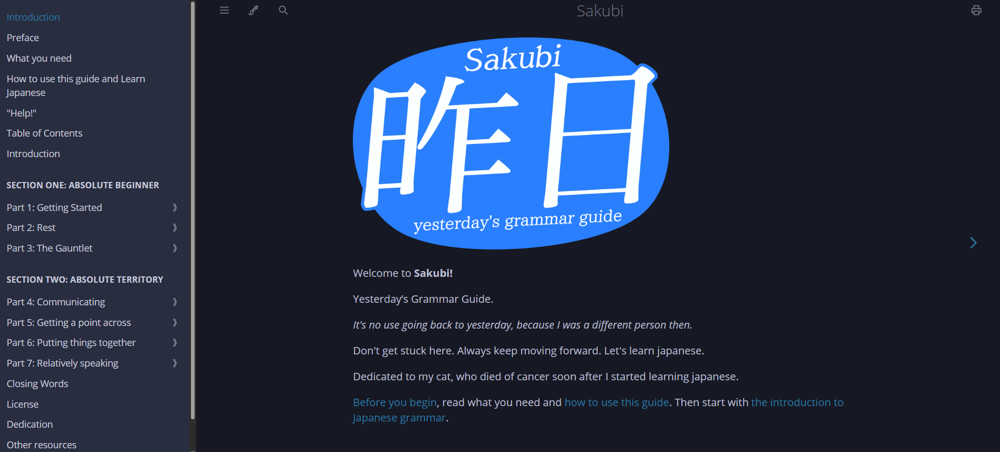

# Sakubi — Yesterday’s Grammar Guide



A free Japanese grammar guide with a book-style reading interface inspired by [Yokubi](https://yoku.bi/Introduction.html).

Original lesson content: [Sakubi](https://sakubi.neocities.org/).

## Features

- **Complete guide:** 54 main lessons, intermissions, optional material, and introductory pages.
- **Easy navigation:** collapsible contents sidebar and previous/next chapter links.
- **Full-text search:** search English or Japanese across the guide.
- **Five themes:** Navy, Light, Rust, Coal, and Ayu.
- **Responsive layout:** desktop reading view and mobile navigation drawer.
- **Local assets:** fonts, images, and search data are included.

## Preview locally

Open **`index.html`** in your browser. No build or installation is needed.

Alternatively, run this command from the project folder:

```bash
python -m http.server 8000
```

Then visit **http://localhost:8000**.

External learning resources and the embedded YouTube video require an internet connection.


**The filename must match exactly**, including uppercase and lowercase letters. Replace `my-screenshot.png` with your actual filename.

```markdown
## Open the website

Open `index.html` in your browser.

```

## Keep the README formatting

Upload the actual **`README.md` file** rather than copying text from a rendered preview. Keep its line breaks and blank lines.

- Headings such as `## Features` belong on their own lines.
- Leave a blank line between paragraphs and before lists or code blocks.
- Put the opening and closing triple backticks of a code block on separate lines.
- Do not wrap the entire README in a code block.

## Reading controls

| Control | Action |
| --- | --- |
| Menu button | Show or hide the contents sidebar |
| Theme button | Choose a reading theme |
| Search button, `S`, or `/` | Search the guide |
| Left/right arrow keys | Go to the previous/next chapter outside form fields |
| Print button | Print the current chapter |
| Preface zoom links | Set reading text to 100%, 150%, or 250% |

Themes and reading preferences are remembered when browser storage is available.

## Edit the website

| File | Purpose |
| --- | --- |
| `index.html` | Home page |
| Other `.html` files | Individual chapters |
| `assets/style.css` | Layout, colors, typography, and responsive styles |
| `assets/app.js` | Sidebar, themes, search, and reading controls |
| `source/sakubi-original.html` | Original guide snapshot used by the generator |
| `build.py` | Rebuilds chapter HTML and the search index |

For source-driven changes, edit `source/sakubi-original.html`, then run:

```bash
python -m pip install -r requirements.txt
python build.py
```

**Rebuilding overwrites direct edits to generated chapter HTML.** The build uses local source and assets; it does not download them.

`Introduction.html` is an alias for the home page. Original `index.html#lesson-id` links redirect to their corresponding chapters.

## Credits and licenses

- **Grammar text and Sakubi logos:** original Sakubi contributors. The source declares its text and logos public domain / CC0; the notice and its qualification about quoted media examples are retained in `license.html`.
- **Layout reference:** [Yokubi](https://yoku.bi/Introduction.html). This edition preserves Sakubi’s original titles, lesson order, and text; it does not contain Yokubi’s rewritten curriculum or claim affiliation with either project.
- **Fonts:** Open Sans, under Apache License 2.0. See `assets/OPEN-SANS-LICENSE.txt`.
- **New reader code and build script:** MIT. See `LICENSE`.

The original repeats its license near the start and end. This edition presents it once on the License page.
